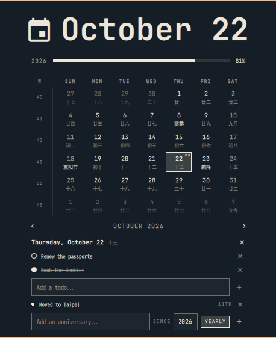

# Chinese Lunar Clock

An Omarchy bar widget that adds the **Chinese lunar calendar** (农历) to the
built-in clock: the lunar date, the traditional festivals, and the twenty-four
solar terms (二十四节气) under every day in the calendar popup — and a day
editor for **todos, birthdays and anniversaries**, on either calendar.



## What it shows

Each day carries a caption beneath its Gregorian number:

- **Festivals** (accent colour) — 春节, 元宵节, 龙抬头, 上巳节, 端午节, 七夕节,
  中元节, 中秋节, 重阳节, 腊八节, 小年, and 除夕.
- **Solar terms** (softer accent) — all twenty-four, from 小寒 to 冬至.
- **The first of a lunar month** prints the month name, e.g. 九月; a leap month
  is marked 闰四月.
- **Every other day** prints its lunar day, 初二 … 三十.

Days from the neighbouring months keep their captions but are dimmed, the way
the Gregorian numbers already are. Press <kbd>l</kbd> in the popup to turn the
captions off; the choice is remembered.

Everything else about the widget is the built-in one: the same calendar grid,
ISO week numbers, week-start toggle (<kbd>w</kbd>), month stepping, year
progress bar, and the optional memento mori bar.

## Todos and anniversaries

Click any day and the popup opens an editor for it under the month rail:

- **Todos** belong to that one day. Type and press <kbd>Enter</kbd> (or
  <kbd>+</kbd>); click a row to tick it off, <kbd>×</kbd> removes it.
- **Birthdays and anniversaries** repeat every year on a date you type, which
  need not be the day you clicked — most of them are years old and somewhere
  else in the calendar. Two rows: the first is the occasion and its calendar,
  the second is the date.

### Entering a date

The **SOLAR / LUNAR** chip picks which calendar the date is written in.

| Calendar | Fields | Notes |
|---|---|---|
| `SOLAR` | one date field | `2015-03-15`, or `2015-3-15`; the year is part of it |
| `LUNAR` | month, day, 闰, `SINCE` year | e.g. `8` `16` → 八月十六 |

A lunar date has no Gregorian year of its own, so the lunar row asks for a
`SINCE` year separately: that is the lunar year the occasion began in, and it is
what the ordinal counts from. While you type, `→ 09-26` appears on the right —
the Gregorian day that lunar date lands on in the `SINCE` year — because that is
the only way to see whether the pair exists at all. A month the year does not
have as a leap month, or a 三十 in a 29-day month, is refused rather than stored
as a record that would never come round.

**A lunar anniversary moves across the Gregorian calendar.** 八月十六 was
2026-09-26 and 2025-10-07; the record follows the lunar date, not the day it was
entered on. That is the point of keeping a birthday on the lunar calendar.

`YEARLY` makes the record repeat; toggle it to `ONCE` for a one-off. Each row
shows the date it is kept on in the calendar it was written in, then the
ordinal: `八月十六 36TH`, `10-22 11TH`, `ONCE`.

A day carrying either kind shows a dot in its cell — filled while a todo is
still open, hollow once they are all done — and a second dot for an
anniversary, so you can see what is coming while browsing months.

Entries are written to a plain JSON file, one record per todo or anniversary:

```
~/.local/share/io.github.twelvejie.lunar-clock/events.json
```

It is watched, so hand edits show up in the popup immediately, and it is
written atomically, so a crash mid-save cannot truncate it. The file is the
whole state: back it up, copy it to another machine, or delete it to start
over. A record that cannot be rendered (a bad date, empty text) is dropped on
load rather than breaking the rest of the file.

Nothing here syncs anywhere — it stays on this machine.

## Reminders

A birthday or anniversary gets a desktop notification **every day in the week
before it**, including the day itself. Nothing to turn on: the widget ships a
service plugin that the shell keeps loaded, so the reminders arrive whether or
not the calendar popup is open.

- Once a day, not once an hour. The store remembers the last day each record was
  reminded on, so restarting the shell, waking the machine, or editing the
  plugin cannot produce a second notification for the same day.
- If the shell was off for the whole week, you get one reminder for today rather
  than a week's backlog.
- It checks hourly, so a machine that was asleep through midnight catches up on
  wake instead of waiting for a restart.
- A record whose date has passed rolls forward to next year rather than going
  quiet.
- A 29 February record simply has no occurrence in a common year; it is not
  quietly moved to the 28th.

Clicking a notification opens the calendar.

### Checking it works

```bash
omarchy-shell reminders due     # what would be notified right now
omarchy-shell reminders check   # run the real path (respects today's stamps)
omarchy-shell reminders reset   # forget today's stamps, so check notifies again
```

Reminders only fire for a record whose date is within seven days. `due` prints
each one with its date and how many days away it is, or `none`.


A lunar record stores its lunar date as the source of truth:

```json
{ "calendar": "lunar", "year": 1990,
  "lunar": { "year": 1990, "month": 8, "day": 16, "isLeap": false },
  "text": "Lunar birthday", "yearly": true }
```

Editing those numbers moves the record; editing `year` moves the year the
ordinal counts from.

## Requirements

- Omarchy (the plugin uses the Quattro shell's bar-widget API)
- A CJK font. Omarchy ships `noto-fonts-cjk`; the widget asks fontconfig for a
  Simplified Chinese face explicitly so the captions use simplified glyph forms
  rather than whichever CJK fallback fontconfig happens to prefer.

The lunar table covers **1900-2100**. Outside that range the captions are simply
blank rather than wrong.

## Install

```bash
omarchy plugin add https://github.com/twelvejie/omarchy-lunar-clock.git --enable
```

To use it as a drop-in replacement for the built-in clock, disable the built-in
one so the bar does not show two clocks:

```bash
omarchy plugin disable omarchy.clock
```

Then click the clock to open the calendar.

## Configure

| Setting | Default | What it does |
|---|---|---|
| `showLunar` | `true` | Captions under each day. Also toggled with <kbd>l</kbd>. |

The label format is the built-in one and can be cycled by right-clicking the
clock; the lunar captions do not appear on the bar label itself.

### Keyboard

Inside the calendar popup:

| Key | Action |
|---|---|
| <kbd>a</kbd> | Jump to the todo field of the open day |
| <kbd>A</kbd> | Jump to the anniversary field of the open day |
| <kbd>l</kbd> | Toggle the lunar captions |
| <kbd>w</kbd> | Start weeks on Monday ⇄ Sunday |
| <kbd>[</kbd> / <kbd>]</kbd> | Previous / next month |
| <kbd>{</kbd> / <kbd>}</kbd> | Previous / next year |
| <kbd>t</kbd> | Back to today |

<kbd>Esc</kbd> in a text field hands the keys back to the panel without losing
what was typed; a second <kbd>Esc</kbd> closes the day, a third closes the
popup.

> The default `SUPER + CTRL + ALT + D` binding summons the built-in `omarchy.clock`,
> so once you replace it with this plugin, rebind it to
> `omarchy-shell shell toggle io.github.twelvejie.lunar-clock` in
> `~/.config/hypr/bindings.lua` if you want that shortcut to keep working.

## Remove

```bash
omarchy plugin remove io.github.twelvejie.lunar-clock
```

## Tests

```bash
./test/lunar-test.sh
./test/events-test.sh
./test/reminders-test.sh
```

`lunar-test.sh` checks known festival and solar-term dates, leap months, New
Year's Eve on both a 廿九 and a 三十 ending, out-of-range degradation, and then
sweeps the whole 1900-2100 range asserting that every day resolves, that each of
the twenty-four solar terms occurs exactly once per year, that each lunar year
has exactly one 除夕, and that no day of a leap month ever matches a festival.

`events-test.sh` covers the todo/anniversary data layer under node: round trips
through the file format, malformed records being dropped instead of taking the
file down, yearly versus one-off matching, immutability of the edit operations,
and the ordinal labels.

`reminders-test.sh` covers the reminder rules: the seven-day window, one
notification per record per day, stamps pruned when a record is deleted, a
passed date rolling forward, 29 February in a common year, and a lunar date
resolving to the right Gregorian day.

## Credits

- **[Omarchy](https://omarchy.org/)** by [37signals / DHH](https://github.com/basecamp/omarchy) —
  `BarWidget.qml`, `Panel.qml`, and `Model.js` are its clock widget and calendar
  panel (MIT), extended here with the lunar captions, the day editor, and the
  <kbd>l</kbd> / <kbd>a</kbd> / <kbd>A</kbd> keys.
- **[chinese-calendar](https://github.com/tigertall/chinese-calendar)** by tiger —
  the lunar year table and conversion algorithm (MIT).
- **[omarchy_chinese_lunar_calendar](https://github.com/GaryLiuGTA/omarchy_chinese_lunar_calendar)**
  by Gary Liu — the solar-term calculation and the Simplified Chinese vocabulary
  (MIT).

See [THIRD-PARTY.md](THIRD-PARTY.md) for the full attribution and
[LICENSE](LICENSE) for the licence text.

## Licence

MIT.
